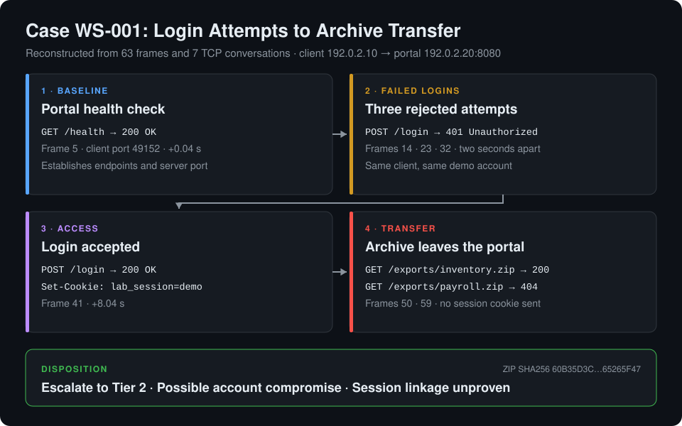
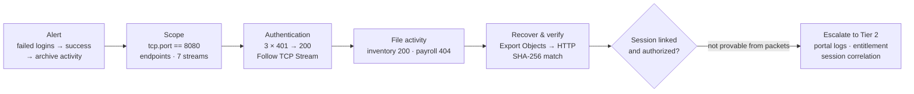

# Wireshark SOC Lab: Login Attempts and Archive Transfer


A hands-on **SOC network investigation** in **Wireshark**. An alert reports repeated login failures against an internal portal, followed by a successful login and a possible file transfer. Working from a deterministic practice capture, I reconstructed all seven TCP conversations, separated the authentication attempts from the archive requests, exported the transferred ZIP from the HTTP stream and **verified it with SHA-256**, then wrote up the case with a frame-cited timeline, an evidence register, escalation gates and a proposed SIEM correlation rule. The same case can be **replayed live on an Ubuntu VM** with `tcpdump` on the loopback interface.

> **What it shows:** how a Tier 1 analyst turns an alert into packet-level evidence, and where that evidence stops. The capture proves an archive crossed the wire to the same client that just logged in. It does **not** prove the logged-in session requested it, so the case is escalated with exactly the questions Tier 2 must answer.



## Why I Did This

Packet captures are the closest thing a SOC has to ground truth, but they are easy to over-read. A `200 OK` is not a successful login until you read the response body, a file request is not a file transfer until you see the bytes, and two events from the same IP are not the same session until something actually links them. I wanted a case small enough to account for every frame, so I could practise reasoning precisely from packets to conclusions, prove that a recovered object is byte-for-byte what crossed the network, and write an escalation that is honest about what the capture can and cannot establish.

## Highlights

- **Alert-driven triage:** case intake with scope, initial priority, five decision gates and a Tier 2 handoff for case `WS-001`.
- **Display-filter workflow:** five targeted filters, from `tcp.port == 8080` to `frame.number == 50`, each tied to an investigative question.
- **TCP stream reconstruction:** **Follow → TCP Stream** used to read each login form body and server reply together, including the `Set-Cookie` on the accepted login.
- **Authentication analysis:** three `401` responses at frames 14, 23 and 32, then a `200` at frame 41 whose body confirms `demo login accepted`.
- **File-transfer scoping:** inventory archive delivered (`200`, `application/zip`) and payroll archive refused (`404`), reported as separate findings.
- **Object recovery and integrity:** ZIP exported with **File → Export Objects → HTTP** and matched to the reference SHA-256 `60b35d3c…65265f47`.
- **Evidence handling:** an evidence register with provenance, a `SHA256SUMS` manifest and separate items for analyst exports and replay captures.
- **Evidence-bounded conclusions:** the export request carries no session cookie, so session linkage and authorization are escalated as open questions rather than assumed.
- **Detection design:** a correlation rule for three or more failures followed by success within five minutes, with eight test cases including deduplication and benign mistypes.
- **Reproducible lab:** a dependency-free Python generator rebuilds the reference PCAP byte-for-byte and replays the case over loopback on Ubuntu.

## Case Summary

| Observation | Evidence in reference PCAP |
|---|---|
| Same client submitted three failed logins | HTTP `401` at frames 14, 23, 32 |
| Portal indicated successful authentication | HTTP `200` and demo session cookie at frame 41 |
| Server transmitted an inventory archive | HTTP `200` at frame 50, ZIP body matches reference SHA-256 |
| Payroll request returned an error | HTTP `404` at frame 59, response body reads `missing` |

## Evidence Timeline

Offsets are relative to frame 1. Client `192.0.2.10`, portal `192.0.2.20:8080`. Each client port identifies one TCP conversation.

| Response time | Client port | Request → response | Observation |
|---|---|---|---|
| +0.040 s | 49152 | 4 → 5 | `GET /health` → `200`, baseline |
| +2.040 s | 49153 | 13 → 14 | `POST /login` → `401` |
| +4.040 s | 49154 | 22 → 23 | Same account → `401` |
| +6.040 s | 49155 | 31 → 32 | Same account → `401` |
| +8.040 s | 49156 | 40 → 41 | `POST /login` → `200`, `demo login accepted`, demo cookie set |
| +10.040 s | 49157 | 49 → 50 | `GET /exports/inventory.zip` → `200` with ZIP body |
| +12.040 s | 49158 | 58 → 59 | `GET /exports/payroll.zip` → `404` with `missing` body |

## Wireshark Analysis

| Step | Display filter | Question it answers |
|---|---|---|
| 1. Establish scope | `tcp.port == 8080` | Who initiates, and which port does the portal listen on? |
| 2. Identify login requests | `http.request.method == "POST" && http.request.uri == "/login"` | How many attempts, and what did each submit? |
| 3. Validate outcomes | `http.response.code == 401 \|\| http.response.code == 200` | Which attempts failed, and does the `200` really mean success? |
| 4. Scope archive requests | `http.request.uri contains "/exports/"` | Which archives were requested, and which were actually delivered? |
| 5. Return to evidence | `frame.number == 50` | What exactly did the inventory response contain? |

Recovering and verifying the transferred object:

```bash
# After File → Export Objects → HTTP → inventory.zip
sha256sum inventory-exported.zip evidence/reference-inventory.zip
unzip -l inventory-exported.zip
```

```text
60b35d3ce7a8f6228a5921fde92978e1fd4dd62f759a9fa6171f1b2965265f47  inventory-exported.zip
60b35d3ce7a8f6228a5921fde92978e1fd4dd62f759a9fa6171f1b2965265f47  evidence/reference-inventory.zip
```

Matching hashes prove the exported bytes are identical to the known lab artifact. The archive contains one member, `inventory.txt`.

The case adapts a source lab's display filters, stream reconstruction, HTTP object export and hashing into an original simulated investigation. Reference: [Wireshark User's Guide: Following Protocol Streams](https://www.wireshark.org/docs/wsug_html_chunked/ChAdvFollowStreamSection.html).

## Detection Design

The case is turned into a proposed SIEM correlation rule in [Detection Design](detections/login-sequence.md):

> For each successful login, look back five minutes for at least **three distinct failed login events** for the same application, account and trusted client IP. Enrich with archive activity in the five minutes after success, but treat it as **session-linked only when a trusted session or request key supports the join**.

| Test case | Expected result |
|---|---|
| Three failures then success, same account, app and IP, within five minutes | Alert |
| Two failures then success | No alert |
| Oldest failure outside the five-minute window | No alert |
| One failure event duplicated three times with the same event ID | No alert |
| User mistypes a password three times, then signs in | Alert for analyst review |
| Archive event shares IP and time but has no trusted session key | Nearby archive activity only |

## MITRE ATT&CK Mapping

| Observed behaviour | Candidate technique | Tactic |
|---|---|---|
| Repeated failed logins for one account | T1110.001 Brute Force: Password Guessing | Credential Access |
| Successful login after the failures | T1078 Valid Accounts | Initial Access, Persistence |
| Archive retrieved from an internal portal | T1213 Data from Information Repositories | Collection |

These are **candidate** mappings that frame the escalation, not findings. Each one depends on Tier 2 confirming that the access was unauthorized, which the packet evidence alone cannot establish.

## Tools & Technologies

- **Wireshark:** display filters, Follow TCP Stream, Decode As, Export Objects → HTTP and time display formats.
- **tcpdump:** full-packet loopback capture (`-i lo -s 0 -U`) with a BPF capture filter.
- **Ubuntu:** VM environment for the live replay.
- **Python 3 (standard library):** deterministic PCAP generator and loopback HTTP replay (`scripts/lab.py`).
- **sha256sum and unzip:** evidence integrity verification and archive inspection.
- **MITRE ATT&CK:** candidate technique mapping for escalation context.

## Investigation Flow



## How This Fits a SOC

```text
Auth alert → pull PCAP → scope endpoints and streams → validate login outcomes
    → scope file activity → export and hash objects → build frame-cited timeline
        ├─ benign explanation confirmed → document and close
        └─ authorization or session linkage unknown → escalate with evidence and open questions
```

The analyst's job is to deliver verified evidence and precise questions, not to stretch the packets into a verdict they cannot support.

## Key Findings

1. **Status codes need context.** The `200` at frame 41 only became a confirmed login after reading the response body and `Set-Cookie` header in the TCP stream.
2. **A request is not a transfer.** Two archives were requested, but only the inventory ZIP was delivered; the payroll request returned a `404`.
3. **Hashes turn exports into evidence.** The exported ZIP's SHA-256 matches the reference artifact, proving byte-level equality.
4. **Same IP is not same session.** The export request carries no session cookie, so the packets cannot link the archive to the authenticated session.
5. **Packets have limits.** A source IP cannot identify a person, and an archive on the wire does not show whether it was saved or opened; portal and identity logs are required.

## Repository Structure

```text
wireshark-soc-lab/
├── README.md
├── LICENSE
├── assets/
│   └── diagrams/
│       └── ws-001-packet-timeline.svg   # case timeline diagram
├── captures/
│   └── reference.pcap                   # synthetic capture, 63 Ethernet frames
├── detections/
│   └── login-sequence.md                # correlation rule and test cases
├── docs/
│   ├── case-intake.md                   # scope, priority and decision gates
│   ├── walkthrough.md                   # Wireshark filters and object recovery
│   ├── incident-report.md               # reference report and handoff
│   ├── replay.md                        # Ubuntu tcpdump replay guide
│   └── analyst-worksheet.md             # template for your own replay
├── evidence/
│   ├── register.md                      # provenance and handling
│   ├── reference-inventory.zip          # expected exported object
│   └── SHA256SUMS                       # integrity manifest
└── scripts/
    └── lab.py                           # PCAP generator and loopback replay
```

## Project Documentation

| Phase | Document | Focus |
|---|---|---|
| 01 | [Case Intake](docs/case-intake.md) | Scope, priority, decision gates and Tier 2 handoff |
| 02 | [Wireshark Walkthrough](docs/walkthrough.md) | Display filters, stream reconstruction and object recovery |
| 03 | [Evidence Register](evidence/register.md) | Artifact provenance, SHA-256 checks and handling |
| 04 | [Incident Report](docs/incident-report.md) | Frame-cited timeline, assessment and open questions |
| 05 | [Detection Design](detections/login-sequence.md) | Correlation logic, telemetry requirements and test cases |
| 06 | [Ubuntu Replay](docs/replay.md) | Live loopback capture with tcpdump |
| 07 | [Analyst Worksheet](docs/analyst-worksheet.md) | Template for recording findings from your own replay |

## How to Review

1. **Read the alert:** start with [Case Intake](docs/case-intake.md) to see the scope and the gates the case must pass.
2. **Work the capture:** open [`captures/reference.pcap`](captures/reference.pcap) in Wireshark and follow the [Walkthrough](docs/walkthrough.md) before reading any conclusions.
3. **Check the conclusions:** compare with the [Incident Report](docs/incident-report.md); note how the assessment separates confirmed observations from open questions.
4. **Verify the evidence:** from the repo root, run

   ```bash
   sha256sum -c evidence/SHA256SUMS
   python3 scripts/lab.py reference   # regenerates identical bytes
   ```

5. **Reproduce it live:** follow the [Ubuntu Replay](docs/replay.md) guide; the script should print `200, 401, 401, 401, 200, 200, 404`.

## Skills Demonstrated

- **Network traffic analysis:** Wireshark display filters, protocol dissection and Decode As.
- **TCP stream reconstruction:** following conversations to pair requests with responses.
- **HTTP analysis:** methods, URIs, status codes, response bodies, content types and cookies.
- **Alert triage:** scoping, priority, benign explanations and decision gates.
- **Evidence handling:** object export, SHA-256 verification, provenance and an evidence register.
- **Timeline building:** frame-cited, time-normalised event reconstruction.
- **Packet capture:** `tcpdump` with capture filters and full snap length on Linux.
- **Detection engineering:** correlation logic, telemetry requirements and test-driven rule design.
- **Escalation writing:** clear handoff to Tier 2 with stated limits of the evidence.
- **Scripting:** a standard-library Python tool that builds PCAPs and replays traffic.

## Roadmap

- Add screenshots from my own Ubuntu replay (the five shots listed in the [walkthrough](docs/walkthrough.md#build-your-own-evidence))
- Complete the [analyst worksheet](docs/analyst-worksheet.md) with replay frame numbers and hashes
- Implement the correlation rule as a Splunk search and test it against generated authentication logs
- Write a Suricata rule for the failure-then-success HTTP pattern and test it against the PCAP
- Add a TLS variant of the case to show what remains observable without decryption

---

## Disclaimer

This project is a controlled simulation for cybersecurity training and portfolio demonstration. The reference capture uses RFC 5737 documentation IP addresses and fictitious credentials, and every artifact in it was generated for this exercise. The Ubuntu replay runs only on the VM's loopback interface and serves a ZIP containing a single lab-generated text file. No real systems, organizations, accounts or user data were involved.

---

## Author

**Anik Nohan**

This lab was built to practise and demonstrate real-world SOC analyst skills in:

- Network alert triage and incident scoping
- Wireshark display filtering and TCP stream reconstruction
- HTTP authentication and file-transfer analysis
- Evidence recovery and integrity verification with SHA-256
- Packet-level timeline reconstruction and escalation to Tier 2
- Detection design for authentication anomalies

Also see my **[Splunk SOC Analyst Detection Lab](https://github.com/aniknohan/splunk-soc-analyst-detection-lab)**, **[MISP Phishing Threat Intelligence Lab](https://github.com/aniknohan/misp-phishing-threat-intelligence-lab)** and **[Phishing Email Investigation Portfolio](https://github.com/aniknohan/phishing-email-investigation-soc-portfolio)**.

### Tools Used

`Wireshark` • `tcpdump` • `Ubuntu` • `Python 3` • `sha256sum` • `unzip` • `MITRE ATT&CK` • `GitHub`

## License

Released under the [MIT License](LICENSE).
